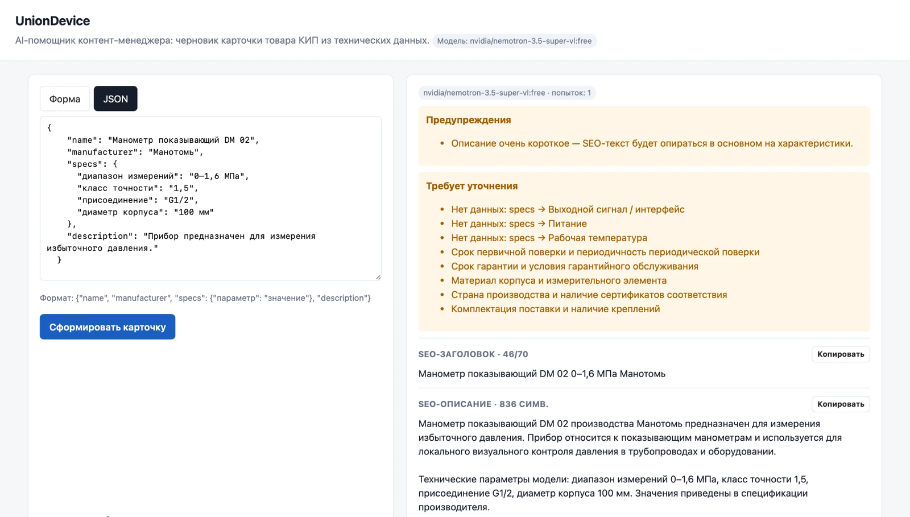
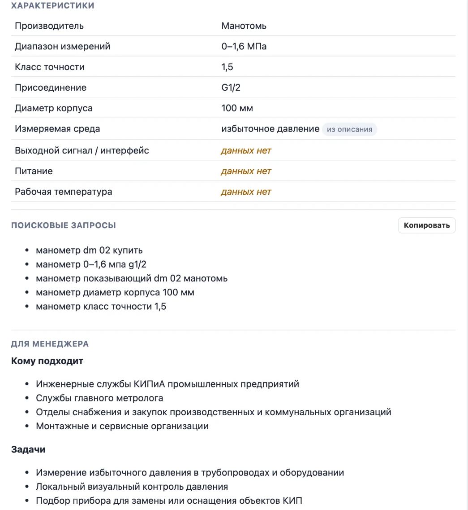
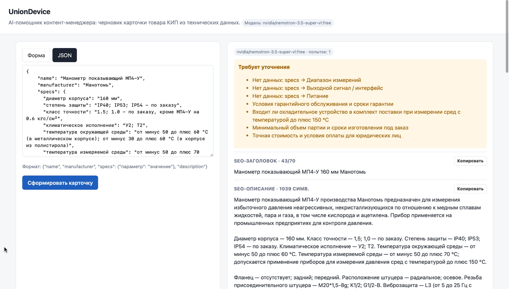
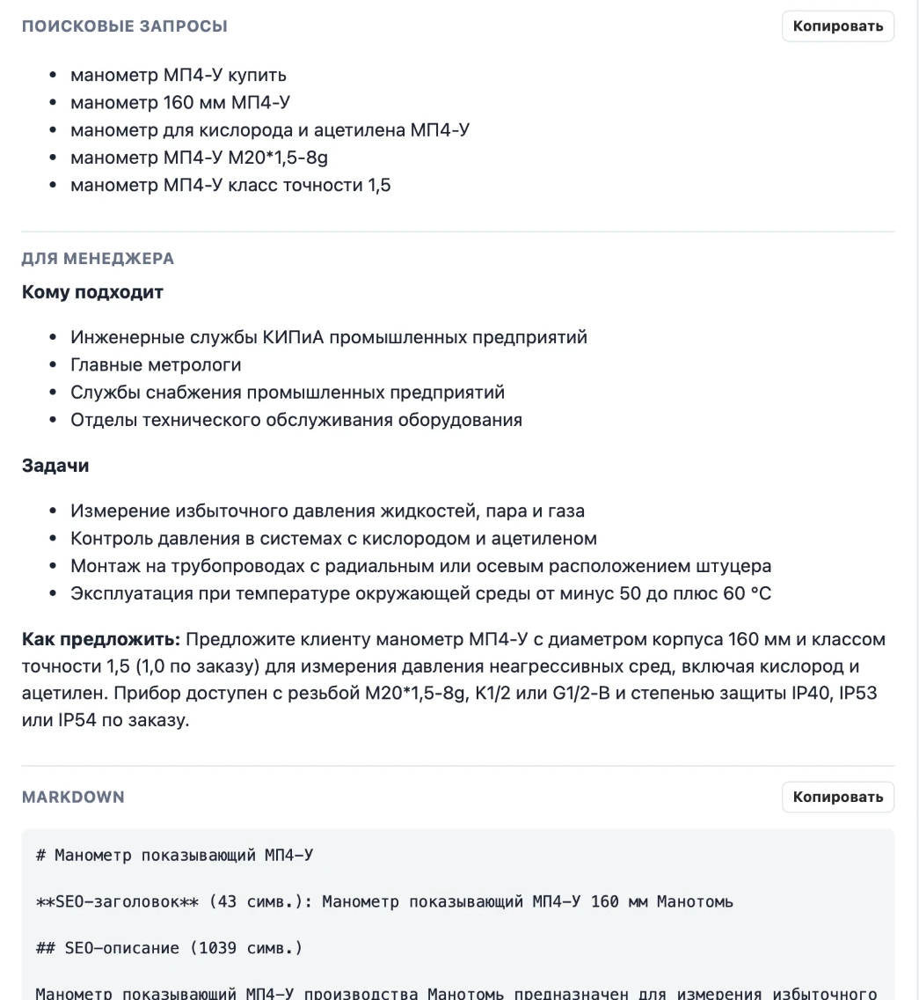

# UnionDevice — AI-помощник для подготовки товарных описаний

Прототип сервиса для B2B-интернет-магазина контрольно-измерительных приборов (КИП). По данным о приборе он готовит черновик карточки товара для контент-менеджера:

- **SEO-заголовок** до 70 символов;
- **SEO-описание** на 800–1200 символов;
- **таблицу ключевых характеристик**: значения только из входных данных, отсутствующие помечены «данных нет»;
- **3–5 поисковых запросов**;
- **блок для менеджера**: кому подходит прибор и какие задачи решает;
- **список того, что нужно уточнить**, и предупреждения.

Данные вводятся в веб-форме или отправляются JSON через API. Результат можно скопировать по полям или целиком в Markdown.

## Установка и запуск

```bash
git clone https://github.com/DaryaKorolevskaya/UnionDevice.git && cd UnionDevice
cp .env.example .env          # впишите OPENROUTER_API_KEY
docker compose up --build
```

Откройте http://localhost:8000. Генерация занимает 20–90 секунд.

Без Docker (Python 3.11+):

```bash
cp .env.example .env
python3 -m venv .venv && source .venv/bin/activate
pip install -r requirements.txt
uvicorn union_device.main:app --reload
```

**Ключ API.** Сервис подключён к [OpenRouter](https://openrouter.ai) и использует только бесплатные модели. Ключ бесплатный и создаётся на https://openrouter.ai/settings/keys, банковская карта не нужна. Ключ хранится в `.env`, который не попадает ни в git, ни в Docker-образ.

**Тесты:** `python -m pytest` (или `docker compose run --rm app python -m pytest`). Ключ и интернет не нужны: LLM в тестах подменяется фейком.

<details>
<summary>Настройки и API</summary>

| Переменная `.env` | По умолчанию | Назначение |
|---|---|---|
| `OPENROUTER_API_KEY` | — | ключ OpenRouter |
| `UNION_MODELS` | Nemotron → Gemma 4 31B → Gemma 4 26B → `openrouter/free` | модели через запятую в порядке приоритета |
| `UNION_BASE_URL` | `https://openrouter.ai/api/v1` | другой OpenAI-совместимый API, например локальная Ollama |
| `UNION_MAX_ATTEMPTS` | `3` | сколько раз модель может исправить черновик |
| `UNION_ALLOW_PAID` | — | `1` разрешает платные модели |

| Метод | Что делает |
|---|---|
| `GET /` | веб-форма |
| `POST /api/generate` | данные товара → `{"card": {...}, "markdown": "..."}` |
| `GET /api/models` | текущие модели и все бесплатные модели OpenRouter |
| `GET /api/health` | задан ли ключ и какая модель используется |
| `GET /docs` | Swagger |

Формат входа:

```json
{
  "name": "Манометр показывающий DM 02",
  "manufacturer": "Манотомь",
  "specs": {"диапазон измерений": "0–1,6 МПа", "класс точности": "1,5"},
  "description": "Прибор предназначен для измерения избыточного давления."
}
```

Ошибки: 422 — некорректные входные данные (в `details` перечислено, что не так); 401/402/429/503/504 — ошибки LLM API (ключ, платная модель, перегрузка, сеть, таймаут).

</details>

## Примеры результатов

Входные данные: [`examples/products.json`](examples/products.json).

**1. Манометр показывающий DM 02** (пример из ТЗ, короткое описание) → [карточка в Markdown](examples/01_manometr_pokazyvayuschiy_dm_02.md)





**2. Манометр показывающий МП4-У** (данные с сайта, нет диапазона измерений) → [карточка в Markdown](examples/02_manometr_pokazyvayuschiy_mp4_u.md)





## Промпты и принятые решения

**Промпты** ([`union_device/core/prompts.py`](union_device/core/prompts.py)):

- **Системный промпт** задаёт роль технического копирайтера B2B-магазина КИП и читателя (инженер КИПиА, метролог, снабженец). Главное правило: технические значения брать только из входных данных, не подставлять «типичные» значения, не писать оценок вроде «высокая точность» и не упоминать гарантию, поверку, сертификаты, если их нет во входе. Дальше описан формат каждого поля и JSON-схема ответа.
- **Сообщение с данными** передаёт товар в блоке `<product>` отдельно от инструкций и явно перечисляет, каких характеристик не хватает.
- **Промпт исправления** перечисляет найденные проблемы («число 2,5 отсутствует во входных данных») и просит удалить лишнее, а не заменить.

**Решения:**

- **Характеристики собирает код, а не модель.** Таблица переносится из входных данных один в один, недостающие характеристики помечаются «данных нет». Если параметр есть только в описании, модель может его вернуть, но лишь с дословной цитатой, которую код проверяет.
- **Ответ модели проверяется кодом.** Числа в тексте сверяются с входными данными, отдельно ищутся «добавки от себя» (высокая точность, надёжность, гарантия и т. п.), проверяются длины. При проблемах модель переписывает черновик (до 3 попыток), а то, что исправить не удалось, показывается в предупреждениях.
- **Некорректные данные отсекаются до LLM.** Битый JSON, нет названия, нет ни характеристик, ни описания → ошибка 422 с понятной причиной.
- **Защита от prompt injection.** Данные отделены от инструкций, теги `<product>` вырезаются из входа, подозрительные команды во входных данных вызывают предупреждение, размер входа ограничен, вывод модели экранируется в интерфейсе.
- **Бесплатные открытые модели через OpenAI-совместимый API.** Модели перебираются по списку: если одна перегружена или недоступна, запрос уходит следующей. Платную модель сервис вызвать не даст.

<details>
<summary>Структура проекта</summary>

```
union_device/
├── main.py              точка входа: веб-форма и HTTP API
├── config/settings.py   настройки из .env, список моделей
├── core/
│   ├── llm.py           LLMClient: запрос к модели, перебор моделей, ошибки API
│   ├── prompts.py       промпты
│   ├── schemas.py       структуры данных: вход, ответ LLM, карточка
│   ├── checks.py        проверки ответа: длины, выдуманные числа и оценки, цитаты
│   └── pipeline.py      сценарий: валидация → LLM → проверки → исправление → карточка
├── utils/
│   ├── validation.py    проверка входного JSON, защита от injection
│   ├── render.py        карточка → Markdown
│   └── free_models.py   список бесплатных моделей OpenRouter
└── web/index.html       веб-форма
examples/                входные данные и готовые карточки
tests/                   тесты
```

</details>

## Сложности

- **Выбор бесплатной LLM.** Gemini API недоступен в ряде регионов, у Claude и GPT нет бесплатного тарифа, а локальная модель на обычном ноутбуке работает медленно и плохо пишет по-русски. Выбран OpenRouter с бесплатными открытыми моделями.
- **Лимиты и нестабильность бесплатных моделей.** Модели часто перегружены, без пополнения баланса доступно около 50 запросов в день, список бесплатных моделей меняется. Отсюда перебор моделей и защита от случайного вызова платной.
- **Модели с рассуждением** тратили весь лимит токенов на «размышления» и не успевали выдать ответ. Помогли короткое рассуждение и переход на следующую модель.
- **Нет строгой JSON-схемы у бесплатных моделей.** Схема передаётся в промпте, ответ проверяется кодом, при ошибке формата модель получает ещё попытку.
- **Модели «додумывают» и плохо считают символы.** Одного промпта мало, поэтому нужны проверки кодом и цикл исправления.

## Ограничения и что можно улучшить

- **Более сильные платные LLM** (GPT, Claude, Gemini, YandexGPT, GigaChat): для MVP использованы бесплатные модели, их качество и стабильность ниже. Подключаются через тот же API сменой настроек.
- **Выбор модели в интерфейсе** и сравнение карточек от разных моделей.
- **Авторизация, личный кабинет и история карточек:** сохранение, повторная генерация, версии.
- **Админ-панель:** пользователи и роли, статусы карточек (черновик → проверка → опубликовано), правка промптов без изменения кода.
- **Пакетная обработка и экспорт:** загрузка каталога в CSV/XLSX, выгрузка в 1С-Битрикс и на маркетплейсы.
- **Загрузка PDF паспорта прибора** с извлечением характеристик и ссылкой на источник каждого значения.
- **Точнее проверка выдумок:** сейчас она ловит числа и типичные формулировки, но не смысловые ошибки. Например, у DM 02 модель указала «измеряемая среда: избыточное давление» — цитата верная, но по смыслу это не среда. Можно добавить второй проход LLM-верификатором.
- **Профили характеристик по категориям:** для механического манометра лишние пометки «питание: данных нет».
- **Eval-набор, логи и мониторинг:** метрики качества, время ответа, частота ошибок и переключений моделей.
